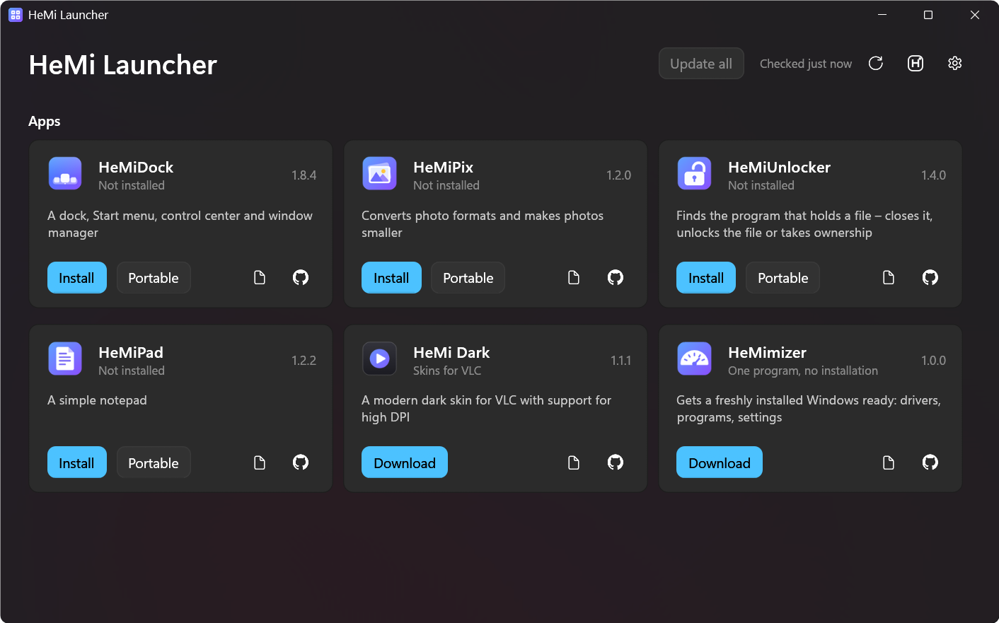

#  HeMi Launcher

[](https://github.com/Hemal1k/HeMiLauncher/releases/latest) [](https://github.com/Hemal1k/HeMiLauncher/releases) [](LICENSE) 

One place for all HeMi apps: **install** them with one click, keep them **up to date** in the background – and HeMi Launcher
updates itself too. Small, in the look of Windows 11, and it talks to nothing but GitHub.

**[Download](https://github.com/Hemal1k/HeMiLauncher/releases/latest)** · [Project page](https://hemal1k.github.io/) · [Report a problem](https://github.com/Hemal1k/HeMiLauncher/issues)



> The downloads are not code-signed, so Windows SmartScreen may warn the first time (More info → Run anyway). Each release has `SHA256SUMS.txt` to check them.

## Download

| File | For |
|---|---|
| `HeMiLauncher-Setup.exe` | The installer – just for you (no administrator) or for all users (Program Files), optionally started with Windows. |
| `HeMiLauncher-Portable.exe` | Just the program for x64; run it from any folder. |
| `HeMiLauncher-Portable-arm64.exe` | The same for Windows on ARM. |

Windows 10 / 11, x64 and ARM64. Nothing else needs to be installed.

## What it does

- **The apps**: [HeMiDock](https://github.com/Hemal1k/HeMiDock), [HeMiPix](https://github.com/Hemal1k/HeMiPix),
  [HeMiUnlocker](https://github.com/Hemal1k/HeMiUnlocker), [HeMiPad](https://github.com/Hemal1k/HeMiPad),
  [HeMiTube](https://github.com/Hemal1k/HeMiTube), [HeMiMizer](https://github.com/Hemal1k/HeMiMizer) and
  [HeMi Dark](https://github.com/Hemal1k/HeMiDark) – each with its version, what's new, Install / Update / Open and Uninstall.
- **Installing** runs the installer of the app with its pages (just for you or for all users, a desktop shortcut…).
  **Updating** runs it quietly – for apps installed for all users Windows asks for administrator rights.
- **Update all** at once; HeMiMizer (one program, run after reinstalling Windows) is downloaded into the Downloads folder.
- Under **Other**: **HeMiTube** (a browser extension for YouTube) is unpacked into `%AppData%\HeMi\HeMiTube`; **Add to browser**
  opens a short guide in the browser you pick (its extensions page and the folder to copy) – the browser loads it once
  (*Developer mode → Load unpacked*), later updates replace it in place (then ⟳ in the browser).
- Under **Other** too: **HeMi Dark** goes straight into VLC: the skins into its skins folder, turned on in its settings; pick the color and the
  size in its card (VLC must be closed meanwhile). Removing it brings the normal look of VLC back.
- **In the background**: after the start and every 4 hours it looks for new versions, shows a Windows notification, and can
  install them by itself (off by default). Closing the window hides it in the notification area; it can start with Windows.
- **Checked downloads**: every installer, exe and zip is compared with `SHA256SUMS.txt` of its release before it is run or unpacked.
- **Portable versions**: downloaded into the Downloads folder (or a folder chosen in the settings) – the launcher updates, opens and removes them there too.
- **Updates itself** – the installed version with its installer, the portable one by replacing its exe.
- **The other HeMi apps** find it (`HKCU\Software\HeMi\HeMiLauncher`): when it is there they leave their updates to it, and
  HeMiDock shows its updates in the status bar.

It reads the releases on GitHub (`api.github.com`, the TLS of Windows) – nothing else, no accounts, no telemetry. Its settings
are in `%AppData%\HeMi\HeMiLauncher\settings.ini`.

## Building

Needs [Rust](https://rustup.rs) (stable, MSVC target) on Windows.

```
cargo build --release
```

The exe is `build\release\HeMiLauncher.exe` (`.cargo\config.toml` sets the build folder and puts the C runtime inside the exe,
so it runs without the Visual C++ Redistributable).

`release.ps1` builds the downloads into `build\dist` (needs [Inno Setup 6](https://jrsoftware.org/isinfo.php); ARM64 also
the MSVC ARM64 build tools): the installer (`installer\HeMiLauncher.iss`) and the portable exes. A release published on GitHub
runs the same script in `.github\workflows\release.yml` and gets the files attached.

## Project

| File | Contents |
|---|---|
| `src\main.rs` | Start: one launcher per user, `--tray` (hidden), `--check`, `--autostart`, `--show` (a click on its notification); for the installer `--repair` and `--set-autostart`. |
| `src\app.rs` | The window: the apps, what's new, settings, About. |
| `src\catalog.rs` | The HeMi apps and what of them is installed (their uninstall entries). |
| `src\github.rs` | The latest releases on GitHub and downloading. |
| `src\jobs.rs` | Installing, updating, uninstalling, the update of the launcher itself. |
| `src\watch.rs` | The shared state and the background checks. |
| `src\tray.rs` | The icon in the notification area. |
| `src\notify.rs` | Windows notifications and `updates.txt` for the other apps. |
| `src\settings.rs` | What it remembers, the start with Windows. |
| `src\theme.rs`, `src\widgets.rs`, `src\i18n.rs`, `src\reg.rs` | The Windows 11 look in egui, two languages, the registry. |
| `assets` | The icons and the notices of the components. |

## License

[MIT](LICENSE).
